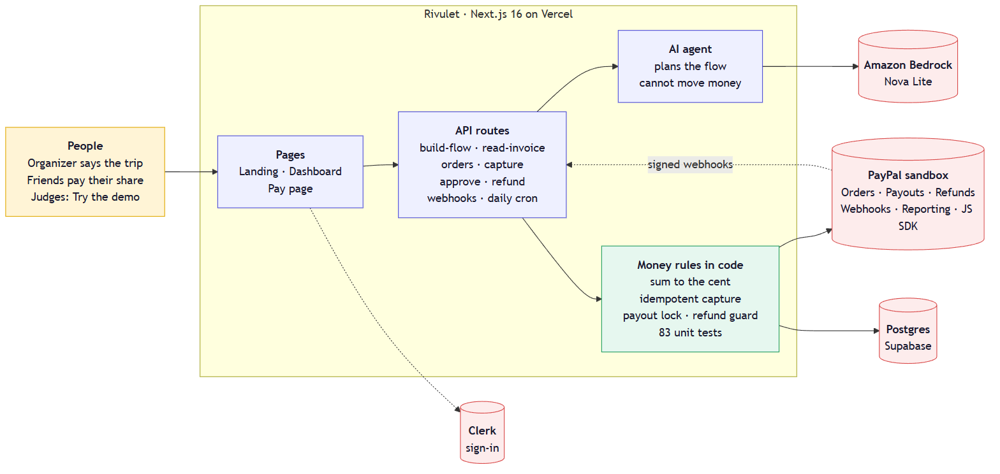
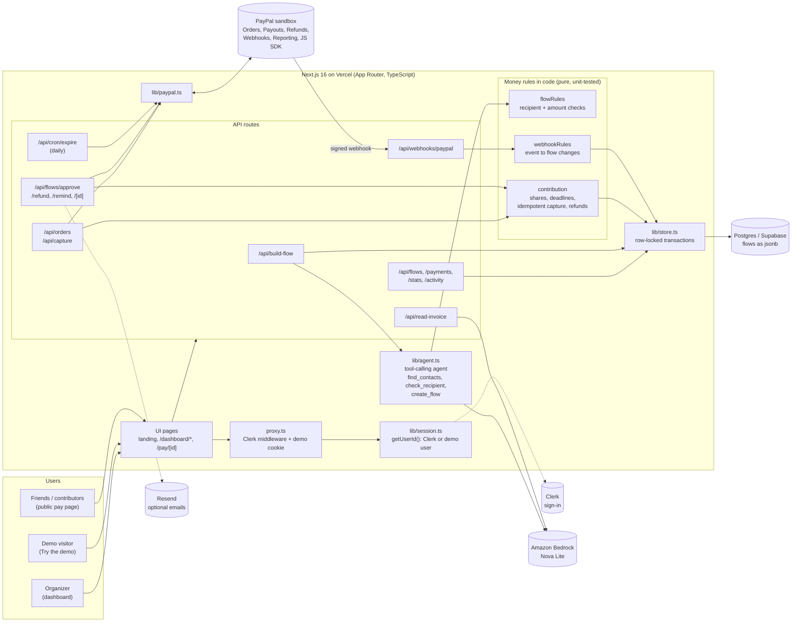
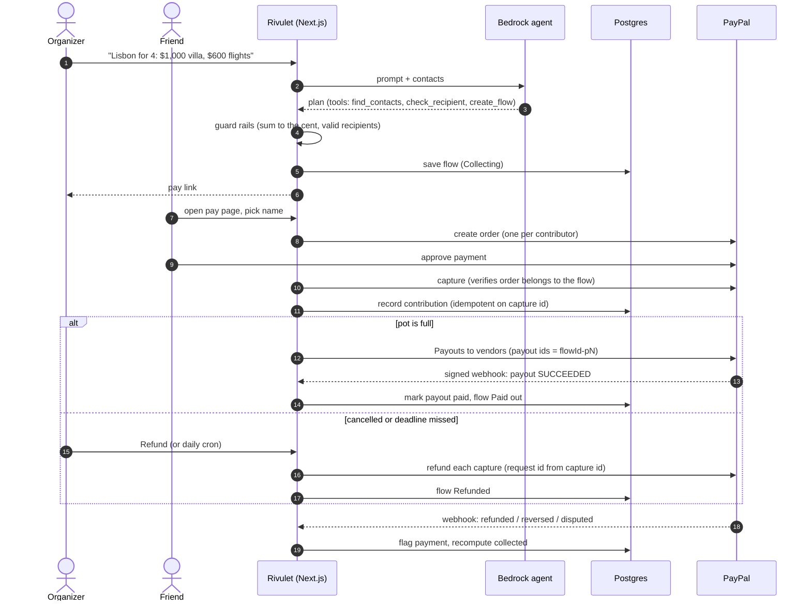
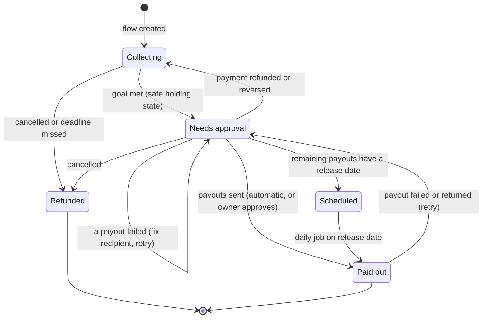
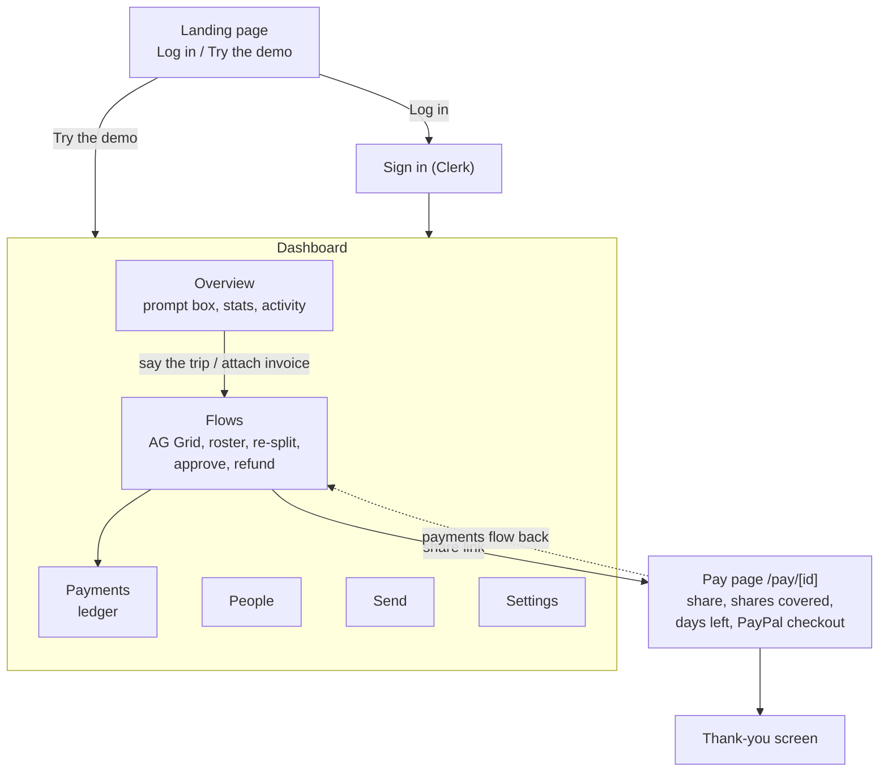
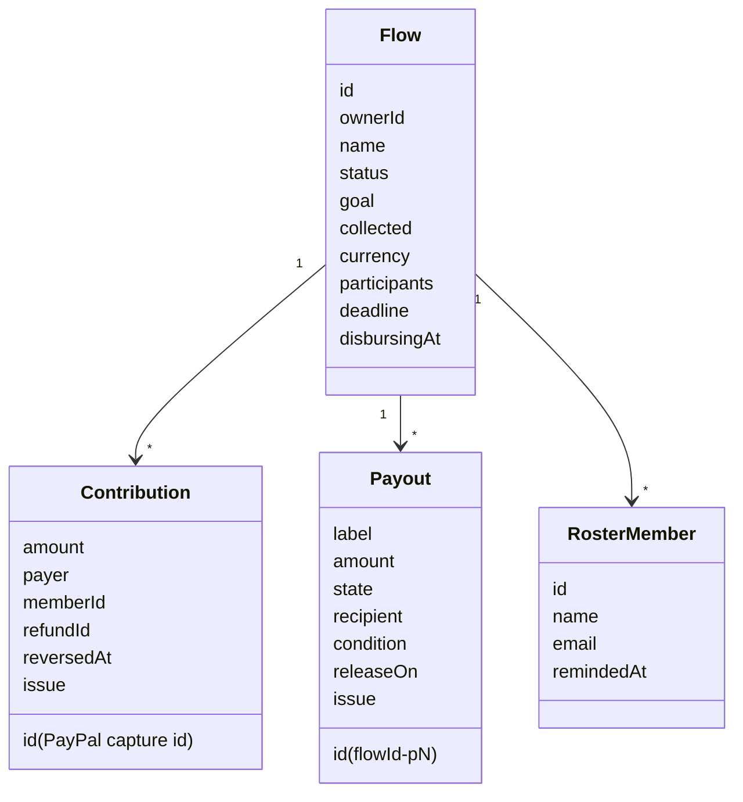

# Rivulet: architecture and design

Diagrams are [Mermaid](https://mermaid.js.org); GitHub renders them in the browser. PNG exports are in `docs/` (sources are the `.mmd` files next to them).

## Overview

## 1. System architecture

Key design decisions:

- **The AI plans; code enforces.** The agent can look up contacts and validate recipients but has no tool that moves money. Amounts must sum to the goal to the cent, and every date or condition must trace to the user's own words.
- **Money rules are pure functions** (`contribution`, `flowRules`, `webhookRules`), so they are unit-tested without a database or network.
- **All writes to a flow run in a row-locked transaction**, with a payout lock so two payout runs, or a payout and a refund, cannot overlap.
- **Public pages see a whitelist** (`publicFlow`): no owner id, no recipient addresses.

## 2. Life of a trip (sequence)

## 3. Flow states

Refunds are refused once any payout has been sent.

## 4. Design: pages and user journey

## 5. Data model (stored per flow, as jsonb)

